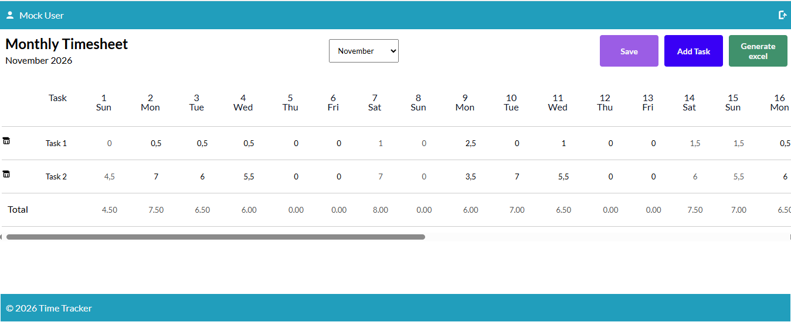

# Time Tracker — Monthly Timesheet

A web application to track working hours per task across a monthly calendar, with Excel export and unit-tested business logic.



## Features

- 🔐 **Login and account creation** with protected routes
- 📅 **Monthly calendar view** with one column per day of the month
- 🗓️ **Month selector** to navigate between months
- ✅ **Add, rename and delete tasks** directly in the table
- ⏱️ **Edit worked hours per day** (weekends are disabled)
- ➕ **Per-task, per-day and grand totals**, recalculated as you type
- 💾 **Save changes** to the backend. All edits (adding, renaming and deleting tasks, and changing hours) stay local until you press **Save**
- ⚠️ **Unsaved changes protection**: you get a warning when you change month, log out or close the tab with unsaved changes
- 📊 **Export to Excel**: generates a formatted `.xlsx` file of the current month
- 🔔 **Alert notifications** for success and error feedback
- 🔌 **Mock / real API switch** via environment variable

## Tech stack

| Technology | Version | Purpose |
|---|---|---|
| [React](https://react.dev/) | 19 | UI framework |
| [React Router](https://reactrouter.com/) | 7 | Routing |
| [TypeScript](https://www.typescriptlang.org/) | 6 | Type safety |
| [Vite](https://vite.dev/) | 8 | Build tool and dev server |
| [ExcelJS](https://github.com/exceljs/exceljs) | 4 | Excel file generation |
| [Vitest](https://vitest.dev/) | 5 | Unit testing |
| [ESLint](https://eslint.org/) | 10 | Linting |
| [Hono](https://hono.dev/) | 4 | Mock API server |
| [concurrently](https://github.com/open-cli-tools/concurrently) | 10 | Runs the frontend and the mock API with a single command |

## Getting started

### Prerequisites

- Node.js `^20.19.0` or `>=22.12.0` (required by Vite 8)

### 1. Install dependencies

The frontend and the mock server have separate dependencies:

```bash
npm install
cd server-mock && npm install && cd ..
```

### 2. Configure environment variables

Copy `.env-example` to `.env` and set the mock server URL:

```bash
VITE_IS_MOCK=true
VITE_BASE_URL=http://localhost:3001
```

| Variable | Values | Description |
|---|---|---|
| `VITE_IS_MOCK` | `true` / `false` | `true` uses the mock server. `false` uses the real API (not implemented yet) |
| `VITE_BASE_URL` | URL | Base URL of the API, e.g. `http://localhost:3001` |

> When `VITE_IS_MOCK=true`, the default month is **November 2026** to match the mock data. Otherwise, the current month is used.

### 3. Run the app

Start the frontend and the mock API together with a single command:

```bash
# Frontend at http://localhost:5173 + mock API at http://localhost:3001
npm run dev:all
```

The output of both processes shares the same terminal, prefixed with `web` (frontend) and `api` (mock server).

Or, if you prefer to run them separately, use two terminals:

```bash
# Terminal 1: mock API at http://localhost:3001
npm run start:api-server

# Terminal 2: frontend at http://localhost:5173
npm run dev
```

**Mock credentials:** username `user1`, password `test`. You can also create a new account from the login page.

## Available scripts

| Script | Description |
|---|---|
| `npm run dev` | Start the development server at `http://localhost:5173` |
| `npm run dev:all` | Start the frontend (`dev`) and the mock API (`start:api-server`) at once, using `concurrently` |
| `npm run build` | Type-check and build for production |
| `npm run preview` | Preview the production build locally |
| `npm run lint` | Run ESLint |
| `npm run test` | Run unit tests with Vitest (watch mode) |
| `npm run test:run` | Run unit tests once (e.g. for CI). Wraps `vitest run` and normalizes the drive letter of the cwd to uppercase, because on Windows a lowercase one (`d:\`) makes Vitest fail |
| `npm run start:api-server` | Start the mock API server (`server-mock/`) |

## Project structure

```
├── server-mock/                  # Mock API (Hono, in-memory data)
│   └── src/
│       ├── index.ts              # Endpoints
│       ├── mock-data.ts          # Initial data (user1)
│       ├── api-model.ts
│       ├── mappers.ts
│       └── routes.ts
└── src/
    ├── common/
    │   ├── components/           # Shared UI: alert, header, footer, table
    │   ├── context/              # React contexts (see below)
    │   ├── helpers/              # Date and general utilities
    │   └── model/                # Dashboard view models shared across pages
    ├── core/
    │   └── router/               # Routes, router and ProtectedRoute
    ├── layouts/                  # AppLayout (header + content + footer)
    ├── pages/                    # One folder per page
    │   ├── login/
    │   ├── create-account/
    │   ├── time-tracker/
    │   └── not-found/
    ├── scenes/                   # Page + layout + providers for each route
    ├── App.tsx
    └── main.tsx
```

### Page anatomy

Every page follows the same layered structure:

```
pages/time-tracker/
├── api/
│   ├── api.ts                    # Public API: picks mock or real based on VITE_IS_MOCK
│   ├── api-mock.ts               # Calls the mock server
│   ├── api-real.ts               # Real API (not implemented yet)
│   └── api-model.ts              # Shapes returned by the API
├── components/                   # Page-specific components
├── *.page.tsx                    # Page component (state and orchestration)
├── *.vm.ts                       # View models used by the UI
├── *.mapper.ts                   # API model ⇄ view model conversion
├── *.business.ts                 # Pure logic (calculations)
├── *.excel.ts                    # Excel export: builds the workbook and downloads the file (time-tracker only)
├── *.validations.ts              # Form validations
└── *.spec.ts                     # Unit tests
```

The UI never consumes API models directly. Data always goes through a mapper, so a change in the API only affects the mapper.

## Routing

| Path | Scene | Access |
|---|---|---|
| `/` | `LoginScene` | Public |
| `/create-account` | `CreateAccountScene` | Public |
| `/time-tracker` | `TimeTrackerScene` | Protected |
| `*` | `NotFoundScene` | Public |

Protected routes are wrapped in `ProtectedRoute` (`src/core/router/protected-router.component.tsx`), which redirects to `/` when there is no logged-in user:

```tsx
<Route
  path={switchRoutes.timeTracker}
  element={<ProtectedRoute><TimeTrackerScene /></ProtectedRoute>}
/>
```

The header (user name and logout) is only shown on the time tracker scene.

> The user is kept in memory only, so **reloading the page logs you out**.

## State management

Global state uses the React Context API. Each context is split into two files: `*-context.ts` holds the context and its hook, and `*-provider.tsx` holds the provider component. This keeps Vite's Fast Refresh working.

| Context | Hook | Provided in | Holds |
|---|---|---|---|
| `UserContext` | `useUserContext()` | `RouterComponent` (whole app) | Logged-in user `{ id, name }` |
| `TimeContext` | `useTimeContext()` | `TimeTrackerScene` | Selected `month` (1–12) and `year` |
| `UnsavedChangesContext` | `useUnsavedChangesContext()` | `TimeTrackerScene` | `isDirty` flag for unsaved changes |

```tsx
import { useTimeContext, useUserContext } from '@/common/context';

const { month, year, setMonth } = useTimeContext();
const { user, setUser } = useUserContext();
```

Each hook returns safe defaults when used outside its provider. For example, `isDirty` is `false`.

`UnsavedChangesContext` sits above `AppLayout` so that both the page and the header can read it:

```
UnsavedChangesProvider
└── AppLayout
    ├── Header              ← asks for confirmation on logout if isDirty
    └── TimeProvider
        └── TimeTrackerPage ← sets isDirty on any edit, resets it after a successful save
```

### Saving model

The time tracker page works like a document: every change is applied to local state only, and pressing **Save** sends the whole month to the server in a single `PUT`. The server replaces all tasks of that month, which also creates new tasks and removes deleted ones. The page then reloads the month from the server.

## Data model

```typescript
interface DashboardModel {
  id: number;                     // Task id
  task: string;                   // Task name
  monthId: number;                // 1–12
  yearId: number;
  workedHours: WorkedHoursModel[];
}

interface WorkedHoursModel {
  value: number;                  // Hours worked (e.g. 7.5)
  taskId: number;                 // Id of the task it belongs to
  dateId: number;                 // 0-based day index (0 = 1st of the month)
}
```

## Mock API

The mock server (`server-mock/`) runs on `http://localhost:3001` with CORS enabled. Data is kept **in memory**: changes are lost when the server restarts.

| Method | Endpoint | Body | Response |
|---|---|---|---|
| `POST` | `/api/login` | `{ name, password }` | `{ id, name }`, or `null` if credentials are wrong |
| `POST` | `/api/create-account` | `{ name, password }` | `{ id, name }`. `400` if fields are missing, `409` if the user already exists |
| `GET` | `/api/dashboard?userId=&monthId=&yearId=` | — | `DashboardModel[]` for that user and month |
| `PUT` | `/api/dashboard?userId=&monthId=&yearId=` | `DashboardModel[]` | `true` / `false`. Replaces all tasks of that month (creates, updates and deletes) |

Example `GET /api/dashboard?userId=1&monthId=11&yearId=2026`:

```json
[
  {
    "id": 1,
    "task": "Task 1",
    "monthId": 11,
    "yearId": 2026,
    "workedHours": [
      { "value": 0, "taskId": 1, "dateId": 0 },
      { "value": 0.5, "taskId": 1, "dateId": 1 }
    ]
  }
]
```

> ⚠️ The mock has no real authentication: any `userId` can be queried. A real backend needs tokens, hashed passwords and input validation.

## Testing

Unit tests cover the pure logic of the app:

| Spec | Covers |
|---|---|
| `time-tracker.business.spec.ts` | Totals and day calculations for the Excel export |
| `time-tracker.excel.spec.ts` | Excel workbook content and styles, file name and file download |
| `time-tracker.mapper.spec.ts` | API model ⇄ view model mapping |
| `table-business.spec.ts` | Table totals and rounding |
| `time-helpers.spec.ts` | Date utilities |
| `common-helpers.spec.ts` | Month names |
| `login.validations.spec.ts` | Login form validation |
| `create-account.validations.spec.ts` | Create account form validation |

```bash
npm run test        # watch mode
npm run test:run    # single run
```

## Path aliases

`@/` points to `src/`, configured in `tsconfig.app.json` (`paths`, no `baseUrl`) and resolved by Vite's native `resolve.tsconfigPaths` option (enabled in `vite.config.ts`):

```typescript
// ❌ Relative path
import { Header } from '../../../common/components/header';

// ✅ Alias
import { Header } from '@/common/components/header';
```

## Gotchas

- **Months are 1-based** (1 = January) everywhere in the app and the API, unlike JavaScript's `Date.getMonth()`, which returns 0–11.
- **`dateId` is 0-based**: `dateId: 0` is the 1st of the month.
- **New tasks** must have one `workedHours` entry per day. Use `createEmptyTrack(getDaysInMonth(month, year).length, month, year)`.
- **Task ids for new tasks are generated on the client** (`Date.now() + Math.random()`). That's fine for the mock, but a real backend should assign ids when saving.

## Backlog

- [ ] Review the Chrome DevTools "Issues" panel (~94 warnings, probably table inputs without `id`/`name`/label) and fix the accessibility ones.
- [ ] Fix the typo `mapUserToUserCredencials` → `mapUserToUserCredentials` in `login.mapper.ts` and its usage in `login.page.tsx`.
- [ ] Review the `React.FormEvent` type, which the IDE reports as deprecated in `login.page.tsx` and `create-account.page.tsx`, and replace it with the recommended alternative.
- [ ] `create-account.scene.tsx` imports its page with a relative path (`../pages/create-account`) because `src/pages/index.ts` does not export `create-account`. Add it to the barrel and import from `@/pages`, like the other scenes. Check for other relative imports that leave their folder.
- [ ] Include the year in the Excel file name (`getExcelFileName` in `time-tracker.excel.ts` returns `time-tracker-november.xlsx`, so files from different years collide when downloaded). Update `getExcelFileName` to take the year, its call in `exportTimesheetToExcel`, and the tests in `time-tracker.excel.spec.ts` that check the file name (`getExcelFileName` and `exportTimesheetToExcel`).
- [ ] `getDaysOfMonth` spec sometimes times out (5000ms) when it runs in parallel with `time-tracker.excel.spec.ts`, which takes ~11s to import exceljs. Investigate a stable fix (e.g. per-test timeout, warming up Intl, or isolating the heavy spec) instead of raising the global timeout.
- [ ] Unify duplicated total calculations: `table-business.ts` (table) and `time-tracker.business.ts` (Excel) compute the same totals with different functions, and `getGrandTotal`/`getTotalHours` are identical. They also differ in edge cases (`find` vs `filter` for a day's total; summing all `workedHours` vs only the month's days for a task total), so the table and the Excel could disagree. Decide the correct behaviour, move a single set of functions to `common/`, use them in both places and merge the tests. Also reuse it for the "1 Sun" day labels (duplicated in `head-table.component.tsx` and `getDaysOfMonth`).

## Work log

### 2026-11-24
- Extracted the Excel generation from `time-tracker.page.tsx` into `time-tracker.excel.ts` (`buildTimesheetWorkbook`, `downloadFile`, `exportTimesheetToExcel`, `getExcelFileName`) and added `time-tracker.excel.spec.ts` (17 tests, Node environment with the DOM download APIs stubbed). `exceljs` is still loaded with a dynamic `import()` (main chunk 277.78 kB, `exceljs` chunk 929.37 kB). The page now only calls `exportTimesheetToExcel` and shows an alert on error: the failure message changed from `Error loading Excel library` to `Error generating Excel file`, and it now also covers failures when writing the file. The backlog item was removed.
- Modernized `tsconfig.app.json`: removed the deprecated `baseUrl` and the `ignoreDeprecations: "6.0"` that silenced it, and `paths` is now `"@/*": ["./src/*"]`. Vite's `resolve.tsconfigPaths` still resolves `@/` (checked with `npm run build` and `npm run test:run`; no other deprecation was hidden). The backlog item was removed.
- Unified file naming (no logic changes): `login-scene.tsx` → `login.scene.tsx`, `actions-component.tsx` → `actions.component.tsx`, `login.mappers.ts` → `login.mapper.ts`, and the `login/component/` and `create-account/component/` folders → `components/`. Also renamed `pages/notFound/` → `pages/not-found/` so every page folder is kebab-case. Imports and the README project tree were updated, and the backlog item was removed.

### 2026-11-23
- Fixed the `// Arrangemodel.Dashboard[]` comment in `time-tracker.mapper.spec.ts`: it is now `// Arrange`, like the rest of the spec. The backlog item was removed.
- Removed the unused `src/core/router/protected-route.tsx`. The app only uses `ProtectedRoute` from `protected-router.component.tsx`, and nothing imported the old file. The backlog item was removed.
- `hideAlert` in `useHideMessage` now keeps the timer id in a `useRef` and calls `clearTimeout` before starting a new one, so a new alert is no longer hidden early by the timer of the previous one. The pending timer is also cleared when the component unmounts. The backlog item was removed.
- Removed the `vite-tsconfig-paths` dev dependency: the `@/` alias is now resolved by Vite's native `resolve.tsconfigPaths: true` in `vite.config.ts`. No tsconfig changes were needed. README "Path aliases" section updated and the backlog item removed.
- `exceljs` is now loaded with a dynamic `import('exceljs')` inside `generateExcelFile` (`time-tracker.page.tsx`), so it is no longer in the main bundle: the main chunk went from 1,205 kB to 278 kB and `exceljs` is a separate ~929 kB chunk downloaded on the first export. If the chunk fails to load, an error alert is shown. The build still warns about that lazy chunk, which is expected.
- Moved `DashboardModel` and `WorkedHoursModel` from `src/common/model` to `src/pages/time-tracker/api/api-model.ts`, following the page anatomy. `DashboardVm` and `WorkedHoursVm` stay in `src/common/model` because the shared table uses them.

### 2026-11-20
- Added the `test:run` script (`scripts/run-vitest.mjs`): runs `vitest run` with the cwd drive letter normalized to uppercase, which fixes the "Cannot read properties of undefined (reading 'config')" failure on Windows. The Stop hook, `CLAUDE.md` and the README now use it.
- Added the `dev:all` script (with the `concurrently` dev dependency) to start the frontend and the mock API with one command. README updated.
- Fixed the `react-hooks/exhaustive-deps` warning in `time-tracker.page.tsx`: `hideAlert` in `useHideMessage` is now memoized with `React.useCallback`, `loadedTrackerList` is wrapped in `React.useCallback`, and the reload effect depends on `[loadedTrackerList]`.
- Fixed swapped contents of `dashboard-model.ts` and `dashboard-vm.ts` in `src/common/model`: the API models are now in `dashboard-model.ts` and the view models in `dashboard-vm.ts`.

### 2026-11-18 / 2026-11-19
- Fixed the build (`tsconfig.json` paths, unused parameters in `api-real.ts`).
- Fixed users being logged in when account creation failed. API errors now throw and show the server message.
- Mock server: `create-account` validates fields and rejects duplicate users (`400` / `409`).
- Deleting a task no longer discards unsaved edits.
- Added unsaved changes protection (month change, logout, closing the tab) through `UnsavedChangesContext`.
- Split contexts into `*-context.ts` and `*-provider.tsx` to fix Fast Refresh lint errors.
- Adding and deleting tasks is now local until **Save**, consistent with editing hours. Removed the `POST /api/dashboard` and `DELETE /api/dashboard/:taskId` endpoints and their API functions.

### 2026-11-17
- Fixed line breaks in alert messages (`white-space: pre-wrap` in `alert.module.css`).
