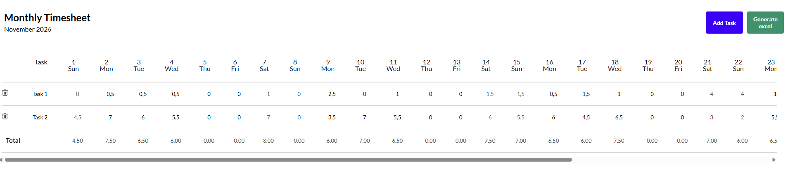

# Time Tracker — Monthly Timesheet

A web application to track working hours per task across a monthly calendar, with Excel export support.



## Features

- 📅 Monthly calendar view with all days of the month as columns
- ✅ Add and delete tasks dynamically
- ✏️ Edit task names and hours directly in the table
- ➕ Per-day totals and grand total row
- 📊 Export the timesheet to a formatted `.xlsx` Excel file
- 🎨 Clean UI with the [Lato](https://fonts.google.com/specimen/Lato) typeface

## Tech stack

| Technology | Version |
|---|---|
| [React](https://react.dev/) | 19 |
| [TypeScript](https://www.typescriptlang.org/) | 6 |
| [Vite](https://vite.dev/) | 8 |
| [ExcelJS](https://github.com/exceljs/exceljs) | 4 |

## Getting started

### Prerequisites

- Node.js 18+

### Installation

```bash
npm install
```

### Running locally

```bash
npm run dev
```

The app will be available at `http://localhost:5173`.

## Available scripts

| Script | Description |
|---|---|
| `npm run dev` | Start the development server |
| `npm run build` | Type-check and build for production |
| `npm run preview` | Preview the production build locally |
| `npm run lint` | Run ESLint |

## Environment variables

| Variable | Values | Description |
|---|---|---|
| `VITE_IS_MOCK` | `true` / `false` | Use mock data instead of the real API |

## Mock API Server

The project includes a mock API server for development and testing.

### Running the mock server

```bash
cd server-mock
npm install
npm run server
```

The server will run on `http://localhost:3001` and provides the following endpoints:

| Method | Endpoint | Description |
|---|---|---|
| `GET` | `/api/dashboard` | Retrieve all tasks with their worked hours |
| `DELETE` | `/api/dashboard/:taskId` | Delete a task by ID |

The mock server includes CORS support and serves static files from the `public` directory.
